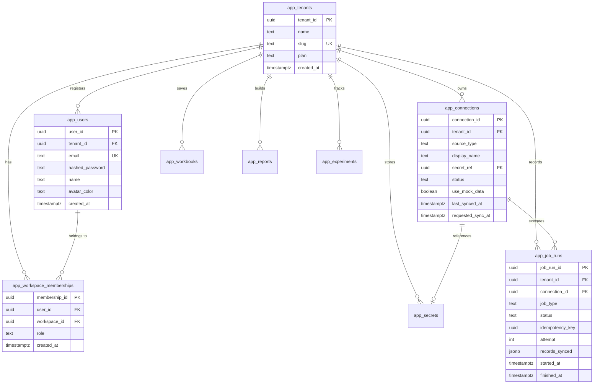
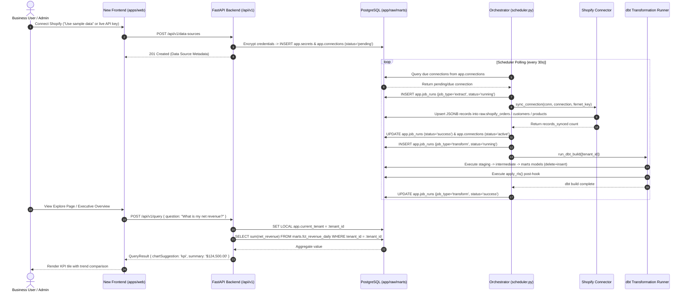

# Apicem Engine — Comprehensive Developer Documentation

> **Document Version:** 1.0.0  
> **Last Updated:** 2026-09-30  
> **Target Audience:** Core Software Engineers, Data Engineers, and System Architects

---

## Table of Contents

1. [Project Overview & Architecture](#1-project-overview--architecture)
2. [Complete Repository & File Structure](#2-complete-repository--file-structure)
3. [Frontend Architecture & Data Flow](#3-frontend-architecture--data-flow)
   - [New Frontend (`new_frontend/apps/web`)](#new-frontend-new_frontendappsweb)
   - [API Contract (`new_frontend/packages/api-contract`)](#api-contract-new_frontendpackagesapi-contract)
   - [Legacy Frontend (`frontend/`)](#legacy-frontend-frontend)
4. [Backend Architecture, Services & APIs](#4-backend-architecture-services--apis)
   - [FastAPI Core (`backend/`)](#fastapi-core-backend)
   - [API Versioning & Route Matrix (v1 vs Legacy)](#api-versioning--route-matrix-v1-vs-legacy)
   - [Metric Registry & Analytics Engine](#metric-registry--analytics-engine)
   - [Natural Language & Intent Resolution Engine](#natural-language--intent-resolution-engine)
   - [Node.js Backend Alternative (`backend-node/`)](#nodejs-backend-alternative-backend-node)
5. [Database Architecture, Schema & Transformations](#5-database-architecture-schema--transformations)
   - [PostgreSQL Schemas (`app`, `raw`, `marts`)](#postgresql-schemas-app-raw-marts)
   - [Two-Role Security & Row-Level Security (RLS)](#two-role-security--row-level-security-rls)
   - [Migration Sequence (`000_` through `021_`)](#migration-sequence-000_-through-021_)
   - [dbt Transformation Pipeline (`warehouse/dbt`)](#dbt-transformation-pipeline-warehousedbt)
6. [Data Connectors & Ingestion Pipeline](#6-data-connectors--ingestion-pipeline)
   - [Connector Architecture (Shopify, Google Ads, Meta Ads, NetSuite)](#connector-architecture)
   - [Orchestrator Scheduler (`orchestrator/scheduler.py`)](#orchestrator-scheduler)
   - [Scoped Incremental Builds & Idempotency](#scoped-incremental-builds--idempotency)
7. [Authentication, Authorization & Security](#7-authentication-authorization--security)
   - [Authentication Lifecycle (Cookie vs Header)](#authentication-lifecycle)
   - [RBAC & Role Hierarchies](#rbac--role-hierarchies)
   - [Credential Envelope Encryption (Fernet)](#credential-envelope-encryption-fernet)
8. [Key Dependencies & Tech Stack](#8-key-dependencies--tech-stack)
9. [Important Workflows & Data Flows](#9-important-workflows--data-flows)
10. [Configuration & Environment Variables](#10-configuration--environment-variables)
11. [Installation, Local Development, Testing & Deployment](#11-installation-local-development-testing--deployment)
12. [Conventions, Assumptions, Limitations & Known Gotchas](#12-conventions-assumptions-limitations--known-gotchas)

---

## 1. Project Overview & Architecture

**Apicem Engine** is a multi-tenant analytics and business intelligence platform tailored for small-to-medium businesses (SMBs) and modern digital commerce brands. It provides an end-to-end data stack in a streamlined footprint:

```
┌────────────────────────────────────────────────────────────────────────────────────────┐
│                                 PRESENTATION LAYER                                     │
│   New Frontend (React 19 + Tailwind + TanStack Query)   |   Legacy Frontend (Vite)     │
│   Port: 5174                                            |   Port: 5173                 │
└───────────────────────────────────────────┬────────────────────────────────────────────┘
                                            │ HTTP / JSON API (Cookie / JWT Auth)
                                            ▼
┌────────────────────────────────────────────────────────────────────────────────────────┐
│                                APPLICATION / API LAYER                                 │
│   FastAPI Python Backend (`backend/`)                   |   Node.js Port (`backend-node`)│
│   • v1 Contract Routes (/api/v1/*)                      |   Port: 8000                 │
│   • Legacy Routes (/auth, /connections, /dashboards)    |                              │
│   • In-House Metric Registry (Single Source of Truth)   |                              │
│   • Deterministic Intent Classifier + Groq Fallback     |                              │
└───────────────────────┬───────────────────────────────────────────────┬────────────────┘
                        │ Read/Write Application State & Marts (RLS)    │
                        ▼                                               │ Triggers & Polls
┌──────────────────────────────────────────────────────────────┐        │
│                       DATABASE LAYER                         │        │
│   PostgreSQL 16/17+ (`apicem` Database)                      │        │
│   • `app` schema: Control plane (Tenants, Users, RBAC)       │        │
│   • `raw` schema: Append-only JSONB landing tables           │        │
│   • `marts` schema: Unified Kimball analytical stars         │        │
│   • Row-Level Security (RLS) enforced via `apicem_app` role   │        │
└───────────────────────────────▲──────────────────────────────┘        │
                                │                                       │
                                │ Direct Ingestion & Mart Rebuilds      │
┌───────────────────────────────┴──────────────────────────────┐        │
│                     ORCHESTRATION & ETL                      │        │
│   Orchestrator (`orchestrator/scheduler.py`) ◄────────────────┘
│   • Polling engine for scheduled & on-demand syncs
│   • Connectors (`connectors/shopify`, `google_ads`, `meta_ads`, `netsuite`)
│   • Scoped dbt runner (`warehouse/dbt`) with RLS post-hooks
└──────────────────────────────────────────────────────────────┘
```

### Core Architectural Principles
1. **Single Source of Truth Metrics**: Every metric (revenue, AOV, ROAS, inventory valuation) is defined exactly once in SQL/Python (`backend/app/metric_registry.py`), eliminating metric drift across dashboards, assistant questions, and exported reports.
2. **Defense-in-Depth Multi-Tenancy**: Tenant isolation is enforced at the database layer via PostgreSQL **Row-Level Security (RLS)** using `SET LOCAL app.current_tenant = :tenant_id` and non-owner roles (`apicem_app`), as well as application-level query filtering.
3. **Deterministic Assistant First**: Natural language queries are mapped deterministically to registered metrics and exact date arithmetic windows. LLM integration (Groq) is strictly a fallback classifier of last resort and is never permitted to calculate or hallucinate numerical values.
4. **Schema-on-Read Landing**: Connectors land raw JSONB payloads keyed on `(tenant_id, source_id)` in the `raw` schema. Transformations occur downstream in dbt (`warehouse/dbt`), isolating connector ingest from API schema drift.

---

## 2. Complete Repository & File Structure

```
apicem_engine_oct26/
├── .env.example                       # Canonical template for environment configuration
├── .gitignore                         # Git exclusion rules
├── docker-compose.yml                 # Multi-container orchestration specification
├── PLAN.md                            # Single source of truth for integration status
├── README.md                          # Quickstart guide and architecture overview
│
├── backend/                           # Primary FastAPI Backend (Python)
│   ├── Dockerfile                     # Container definition for Python API
│   ├── requirements.txt               # Production Python dependencies
│   ├── requirements-dev.txt           # Test and linting dependencies (pytest, httpx)
│   ├── app/
│   │   ├── __init__.py
│   │   ├── main.py                    # FastAPI application initialization & CORS config
│   │   ├── config.py                  # Pydantic Settings management (reads root .env)
│   │   ├── db.py                      # SQLAlchemy engine, SessionLocal, and RLS session helpers
│   │   ├── security.py                # JWT creation/verification, password hashing, session cookies
│   │   ├── rate_limit.py              # In-memory sliding window rate limiter
│   │   ├── email.py                   # SMTP mailer with console dev-fallback
│   │   ├── metric_registry.py         # Canonical metric definitions (Scalar, Series, Table SQL)
│   │   ├── assistant_intents.py       # Deterministic regex & intent matcher for natural queries
│   │   ├── groq_fallback.py           # Optional Groq LLM classifier fallback
│   │   ├── dashboard_registry.py      # Legacy dashboard metadata & source capability matrix
│   │   ├── schemas.py                 # Legacy Pydantic request/response models
│   │   ├── routers/                   # Legacy API Routes (Port 5173 compatible)
│   │   │   ├── auth.py                # Legacy signup, login, password reset, demo login
│   │   │   ├── connections.py         # Legacy connection management & secrets storage
│   │   │   ├── sync.py                # Legacy manual sync trigger
│   │   │   ├── metrics.py             # Legacy raw metric computation endpoint
│   │   │   ├── dashboards.py          # Legacy dashboard definitions & rendering
│   │   │   ├── team.py                # Legacy team membership & role management
│   │   │   ├── assistant.py           # Legacy Ask Apicem Engine endpoint
│   │   │   └── tenant.py              # Legacy tenant rename & logo upload
│   │   └── v1/                        # v1 API Routes (matching @apicem/api-contract)
│   │       ├── __init__.py
│   │       ├── schemas.py             # Pydantic models matching TypeScript contract (camelCase)
│   │       ├── auth.py                # v1 session auth, login, signup, logout, /me
│   │       ├── workspace.py           # v1 workspaces, memberships, switching, profile
│   │       ├── data_sources.py        # v1 data source management, schema inspection, sync history
│   │       ├── analytics.py           # v1 metrics, starter questions, /query, pivot queries
│   │       ├── workbooks.py           # v1 saved exploratory workbooks CRUD & view counter
│   │       ├── reports.py             # v1 custom multi-block report builder CRUD
│   │       ├── experiments.py         # v1 marketing/conversion experiment tracking CRUD
│   │       └── avatar.py              # Deterministic avatar color generator
│   ├── tests/                         # Comprehensive pytest test suite (85+ tests)
│   │   ├── conftest.py                # DB fixtures, auto-disposable tenant setup & teardown
│   │   ├── test_rls_isolation.py      # Cross-tenant data isolation proof
│   │   ├── test_v1_*.py               # Test suites for each v1 API domain
│   │   └── ...
│   └── uploads/                       # Local disk storage for workspace logos
│
├── backend-node/                      # Alternate Node.js/TypeScript Backend Port
│   ├── package.json                   # Express, TypeScript, pg, jsonwebtoken
│   ├── tsconfig.json
│   ├── vitest.config.ts
│   └── src/
│       ├── main.ts                    # Express app bootstrap
│       ├── db.ts                      # pg Pool with RLS tenant context setter
│       ├── config.ts                  # Node.js environment configuration
│       ├── security.ts                # Bcrypt, JWT, and session handlers
│       ├── metricRegistry.ts          # TypeScript port of metric SQL definitions
│       ├── assistantIntents.ts        # Intent parser and date arithmetic
│       ├── fernet.ts                  # Fernet decryption utility
│       └── routes/                    # Express route controllers
│
├── connectors/                        # Data Ingestion Connectors
│   ├── shopify/
│   │   ├── client.py                  # Shopify Admin REST API client (cursor pagination, backoff)
│   │   ├── mock_data.py               # Deterministic synthetic data generator (250 orders)
│   │   └── sync.py                    # Shopify extract logic (Orders, Customers, Products)
│   ├── google_ads/                    # Google Ads API client, mock generator, and extract logic
│   ├── meta_ads/                      # Meta Marketing API client, mock generator, and extract logic
│   └── netsuite/                      # NetSuite SuiteTalk client, mock generator, and extract logic
│
├── orchestrator/                      # Orchestration & Pipeline Runner
│   ├── Dockerfile
│   ├── requirements.txt               # psycopg2, python-dotenv, dbt-core, dbt-postgres
│   ├── scheduler.py                   # Main polling daemon for scheduled & triggered jobs
│   └── dbt_runner.py                  # Python interface executing scoped dbt builds
│
├── warehouse/                         # Data Warehouse Definitions
│   ├── sql/                           # Ordered PostgreSQL Initialization & Migration Scripts
│   │   ├── 000_create_app_role.sh     # Bootstraps `apicem` owner & `apicem_app` restricted roles
│   │   ├── 001_extensions.sql         # pgcrypto extension setup
│   │   ├── 002_app_schema.sql         # Core control plane tables (tenants, users, secrets, jobs)
│   │   ├── 003_raw_schema.sql         # Raw Shopify landing tables
│   │   ├── 004_rls.sql                # Row-Level Security policies on app schema
│   │   ├── 005_grants.sh              # Grants permissions to apicem_app role
│   │   ├── 006_login_lookup.sh        # Security Definer function for cross-tenant login resolution
│   │   ├── 007_reset_password_function.sh # Security Definer function for password resets
│   │   ├── 008_ads_and_erp_raw_schema.sql # Raw tables for Ads & NetSuite ERP
│   │   ├── 009_expand_connections.sql # Multi-source connection support
│   │   ├── 010_tenant_branding.sql    # Custom logo & branding columns
│   │   ├── 011_assistant_messages.sql # Assistant message logging table
│   │   ├── 012_user_profile_fields.sql# User display name and avatar fields
│   │   ├── 013_login_lookup_name.sql  # Expanded login lookup returning user profile
│   │   ├── 014_workspace_memberships.sql # Multi-workspace many-to-many RBAC model
│   │   ├── 015_user_visibility_across_memberships.sql # Membership visibility RLS
│   │   ├── 016_tenant_slug_trigger.sql# URL-friendly slug generation triggers
│   │   ├── 017_seed_membership_trigger.sql # Auto-seeds memberships on user registration
│   │   ├── 018_fix_current_user_id_cast.sql # Fixes GUC casting under connection pooling
│   │   ├── 019_v1_connection_metadata.sql # Idempotency and attempt metadata on job runs
│   │   ├── 020_v1_workbooks_reports_experiments.sql # Workbooks, reports, and experiments tables
│   │   └── 021_marts_schema.sql       # Marts DDL and RLS policies for analytics
│   └── dbt/                           # dbt Project for Warehouse Transformations
│       ├── dbt_project.yml            # dbt configuration with incremental strategies & post-hooks
│       ├── profiles.yml               # Postgres connection profile
│       ├── macros/
│       │   ├── apply_rls.sql          # Post-hook macro re-applying RLS after table materialization
│       │   └── tenant_scope.sql       # Tenant-scoping predicate for incremental builds
│       └── models/
│           ├── staging/               # Views cleaning and casting raw JSONB payloads
│           ├── intermediate/          # Views joining and standardizing cross-source entities
│           └── marts/                 # Dimensional stars (core, marketing, inventory, shared)
│
├── frontend/                          # Legacy React Frontend
│   ├── package.json                   # React 18, Vite, Recharts, Lucide-React
│   ├── vite.config.ts
│   ├── nginx.conf                     # Production container web server configuration
│   └── src/                           # Component tree, context providers, and dashboard views
│
└── new_frontend/                      # Modern Monorepo Frontend
    ├── package.json                   # Workspace configuration (`apps/*`, `packages/*`)
    ├── packages/
    │   └── api-contract/              # Canonical TypeScript Zod Schemas & Domain Types
    │       ├── package.json
    │       └── src/
    │           ├── entities.ts        # User, Workspace, Metric, Report, Workbook, Experiment types
    │           └── requests.ts        # Request payload contracts and validation rules
    └── apps/
        └── web/                       # React 19 Single Page Application
            ├── package.json           # React 19, Tailwind CSS, TanStack Query, React Router
            ├── vite.config.ts
            └── src/
                ├── api/               # API Clients (Real Backend Adapter & Mock Fallback)
                │   ├── client.ts      # HTTP client configured with credentials/cookies
                │   ├── hooks.ts       # TanStack Query custom hooks
                │   └── real/adapter.ts# v1 REST Adapter calling FastAPI `/api/v1`
                ├── app/               # Page Components (Home, Explore, Connections, Reports, etc.)
                ├── components/        # Design system components (Sidebar, TopNav, Shelves, Charts)
                └── stores/            # State stores (Zustand) for UI state and active filters
```

---

## 3. Frontend Architecture & Data Flow

### New Frontend (`new_frontend/apps/web`)

The new frontend is built with **React 19**, **Vite**, **Tailwind CSS**, and **TanStack Query (React Query v5)**.

```
┌────────────────────────────────────────────────────────────────────────┐
│                        User Interface Layer                            │
│   ExplorePage  |  HomePage  |  ConnectionsPage  |  ReportsListPage     │
└───────────────────────────────────┬────────────────────────────────────┘
                                    │ Calls Custom Query/Mutation Hooks
                                    ▼
┌────────────────────────────────────────────────────────────────────────┐
│                     Data Fetching & Caching Layer                      │
│   `src/api/hooks.ts` (TanStack Query)                                  │
│   • Cache Invalidation on Mutations                                    │
│   • Background Stale-While-Revalidate                                  │
└───────────────────────────────────┬────────────────────────────────────┘
                                    │ Invokes ApiAdapter Interface
                                    ▼
┌────────────────────────────────────────────────────────────────────────┐
│                          API Adapter Layer                             │
│   `src/api/real/adapter.ts`  ◄─── Switchable via `VITE_USE_MOCK` ───►  `src/api/mock/adapter.ts`
│   • Communicates with `/api/v1/*`                                      │
│   • Automatic Cookie Credentials Inclusion                             │
└────────────────────────────────────────────────────────────────────────┘
```

#### Key Architecture Patterns
- **API Adapter Pattern**: The frontend interacts strictly with an abstract `ApiAdapter` interface. In development/testing, it can run completely standalone using `mock/adapter.ts` (`VITE_USE_MOCK=true`) or against the real backend (`VITE_USE_MOCK=false`).
- **Contract Enforcement**: All API types, payloads, and responses are defined in the workspace package `@apicem/api-contract` using Zod.
- **State Management**:
  - **Server State**: Managed via TanStack Query (`queryClient.ts`) with dedicated query keys (`['workspace']`, `['metrics']`, `['data-sources']`, `['workbooks']`).
  - **Client/UI State**: Managed via lightweight **Zustand** stores (`src/store.ts`) for transient UI states (shelf open/close, active exploration query drafts, visualization configurations).
- **Navigation & Routing**: Built on `react-router-dom` with prefetching capabilities (`route-prefetch.ts` and `route-preload.ts`).

### API Contract (`new_frontend/packages/api-contract`)

The contract defines the schema boundary between frontend and backend:
- [`entities.ts`](file:///c:/Users/LAPTOP%20SHOP/Documents/Aayush/apicem_engine/apicem_engine_oct26/new_frontend/packages/api-contract/src/entities.ts): Core TypeScript interfaces (`User`, `Workspace`, `WorkspaceSummary`, `Metric`, `StarterQuestion`, `QueryResult`, `PivotResult`, `Workbook`, `Report`, `Experiment`).
- [`requests.ts`](file:///c:/Users/LAPTOP%20SHOP/Documents/Aayush/apicem_engine/apicem_engine_oct26/new_frontend/packages/api-contract/src/requests.ts): Input schemas with strict validation constraints (e.g., `CreateWorkspaceInputSchema`, `RunQueryInputSchema`, `CreateExperimentInputSchema`).

### Legacy Frontend (`frontend/`)

The legacy frontend is an independent React 18 application located in `frontend/`:
- Uses vanilla CSS design tokens (`src/styles.css`) and pure CSS variables.
- Uses **React Context** (`AuthContext`, `TenantContext`) storing JWT tokens in memory/local storage.
- Renders Executive Overview, Revenue, Marketing, and Product Performance dashboards using **Recharts**.

---

## 4. Backend Architecture, Services & APIs

### FastAPI Core (`backend/`)

The backend is written in **Python 3.12** using **FastAPI** and **SQLAlchemy**. It is designed with modular routers, strict dependency injection, and centralized configuration.

```
Incoming Request
       │
       ▼
CORSMiddleware (Matches LAN private IPs & localhost on ports 5173 / 5174)
       │
       ▼
Exception Handler (Ensures CORS headers are preserved on 500 errors)
       │
       ▼
Authentication Dependency (`get_current_user`)
 ├── Reads `apicem_session` HttpOnly Cookie (Primary for v1)
 └── Reads `Authorization: Bearer <token>` Header (Legacy fallback)
       │
       ▼
Tenant Context Dependency (`get_tenant_db`)
 ├── `SET LOCAL app.current_tenant = :tenant_id`
 ├── `SET LOCAL app.current_user_id = :user_id`
 └── Resolves active role from `app.workspace_memberships`
       │
       ▼
Route Handler & Business Logic Execution
```

### API Versioning & Route Matrix (v1 vs Legacy)

| Category | Method & Path | Auth Dependency | Handler / File | Description |
|---|---|---|---|---|
| **System** | `GET /health` | Public | `main.py` | Health check endpoint |
| **v1 Auth** | `GET /api/v1/me` | Cookie / Bearer | `v1/auth.py` | Returns current user profile and active workspace |
| | `POST /api/v1/auth/login` | Public (Rate Limited) | `v1/auth.py` | Authenticates and sets `apicem_session` cookie |
| | `POST /api/v1/auth/signup` | Public (Rate Limited) | `v1/auth.py` | Registers user, tenant, workspace membership |
| | `POST /api/v1/auth/logout` | Public | `v1/auth.py` | Clears `apicem_session` cookie |
| **v1 Workspaces** | `GET /api/v1/workspace` | Tenant Member | `v1/workspace.py` | Returns current workspace details & role |
| | `GET /api/v1/workspaces` | Authenticated User | `v1/workspace.py` | Lists all workspaces user belongs to |
| | `POST /api/v1/workspaces` | Authenticated User | `v1/workspace.py` | Creates new workspace (user becomes owner) |
| | `POST /api/v1/workspaces/{id}/switch` | Workspace Member | `v1/workspace.py` | Switches active workspace session cookie |
| | `GET /api/v1/workspace/members` | Tenant Member | `v1/workspace.py` | Lists workspace team members |
| | `PATCH /api/v1/workspace/members/{id}` | Owner / Admin | `v1/workspace.py` | Updates team member role |
| **v1 Data Sources** | `GET /api/v1/data-sources` | Tenant Member | `v1/data_sources.py` | Lists data source connections and sync status |
| | `POST /api/v1/data-sources` | Owner / Admin | `v1/data_sources.py` | Creates connection with Fernet encrypted credentials |
| | `GET /api/v1/data-sources/{id}/schema`| Tenant Member | `v1/data_sources.py` | Returns scanned tables and column metadata |
| | `DELETE /api/v1/data-sources/{id}` | Owner / Admin | `v1/data_sources.py` | Deletes connection and encrypted secrets |
| | `POST /api/v1/data-sources/{id}/sync` | Owner / Admin | `v1/data_sources.py` | Queues immediate sync with `Idempotency-Key` |
| | `GET /api/v1/data-sources/{id}/sync-runs` | Tenant Member | `v1/data_sources.py` | Lists historical extraction runs |
| **v1 Analytics** | `GET /api/v1/metrics` | Public / Member | `v1/analytics.py` | Lists 22 registered business metrics & metadata |
| | `GET /api/v1/starter-questions` | Public / Member | `v1/analytics.py` | Returns curated starter analytics questions |
| | `POST /api/v1/query` | Tenant Member | `v1/analytics.py` | Executes natural language or structured query |
| | `GET /api/v1/blocks/data` | Tenant Member | `v1/analytics.py` | Fetches data for dashboard/report blocks |
| | `POST /api/v1/pivot-query` | Tenant Member | `v1/analytics.py` | Executes multi-dimensional pivot cross-tab |
| **v1 Workbooks** | `GET /api/v1/workbooks` | Tenant Member | `v1/workbooks.py` | Lists saved exploratory workbooks |
| | `POST /api/v1/workbooks` | Tenant Member | `v1/workbooks.py` | Saves new workbook/exploration |
| | `GET /api/v1/workbooks/{id}` | Tenant Member | `v1/workbooks.py` | Gets workbook layout & query definition |
| | `POST /api/v1/workbooks/{id}/view` | Tenant Member | `v1/workbooks.py` | Atomically increments view counter |
| | `DELETE /api/v1/workbooks/{id}` | Tenant Member | `v1/workbooks.py` | Deletes workbook |
| **v1 Reports** | `GET /api/v1/reports` | Tenant Member | `v1/reports.py` | Lists custom multi-block reports |
| | `POST /api/v1/reports` | Tenant Member | `v1/reports.py` | Creates new report |
| | `GET /api/v1/reports/{id}` | Tenant Member | `v1/reports.py` | Gets report details and block layouts |
| | `PATCH /api/v1/reports/{id}` | Tenant Member | `v1/reports.py` | Updates report name, description, and blocks |
| | `DELETE /api/v1/reports/{id}` | Tenant Member | `v1/reports.py` | Deletes report |
| **v1 Experiments**| `GET /api/v1/experiments` | Tenant Member | `v1/experiments.py` | Lists marketing & conversion experiments |
| | `POST /api/v1/experiments` | Tenant Member | `v1/experiments.py` | Creates new experiment card |
| | `GET /api/v1/experiments/{id}` | Tenant Member | `v1/experiments.py` | Gets experiment configuration & lift results |
| | `PATCH /api/v1/experiments/{id}` | Tenant Member | `v1/experiments.py` | Updates experiment parameters |
| | `DELETE /api/v1/experiments/{id}` | Tenant Member | `v1/experiments.py` | Deletes experiment |
| **Legacy Routes** | `POST /auth/login` | Public | `routers/auth.py` | Legacy login returning JWT token in body |
| | `GET /dashboards/{id}` | Tenant Member | `routers/dashboards.py` | Legacy dashboard data loader |
| | `POST /assistant/ask` | Tenant Member | `routers/assistant.py` | Legacy assistant endpoint |
| | `PATCH /tenant` | Owner / Admin | `routers/tenant.py` | Workspace rename & logo upload |

### Metric Registry & Analytics Engine

[`backend/app/metric_registry.py`](file:///c:/Users/LAPTOP%20SHOP/Documents/Aayush/apicem_engine/apicem_engine_oct26/backend/app/metric_registry.py) acts as the unified analytics computation layer. Metrics are divided into three types:

1. **Scalar Metrics** (`SCALAR_METRICS`): Return a single numerical aggregate over a date window with period-over-period comparison capabilities (`compare=True`):
   - `gross_revenue`, `net_revenue`, `order_count`, `total_discounts`, `total_refunds`, `new_customer_count`, `aov`, `gross_margin_pct`
   - `total_ad_spend`, `total_conversions`, `blended_roas`, `blended_cpa`, `blended_ctr`
   - `total_inventory_value`, `total_units_on_hand`, `low_stock_count`
2. **Series Metrics** (`SERIES_METRICS`): Return daily time-series data:
   - `revenue_trend` (daily gross and net revenue)
   - `discounts_refunds_trend` (daily discounts vs refunds)
   - `ad_spend_trend` (daily Google Ads vs Meta Ads spend)
3. **Table Metrics** (`TABLE_METRICS`): Return structured entity breakdowns:
   - `top_products` (top products by revenue and units sold)
   - `campaign_performance` (spend, clicks, impressions, ROAS, CPA by campaign)
   - `inventory_by_product` (stock availability and inventory value sorted by lowest quantity)

### Natural Language & Intent Resolution Engine

Located in [`backend/app/assistant_intents.py`](file:///c:/Users/LAPTOP%20SHOP/Documents/Aayush/apicem_engine/apicem_engine_oct26/backend/app/assistant_intents.py):
- **Deterministic Matcher**:
  - `METRIC_PHRASES`: Dictionary mapping metric keys to recognized phrasing lists. Matching uses longest-matching substring algorithm.
  - `match_date_window(question, today)`: Parses explicit months (e.g., "July 2026"), relative intervals ("last 30 days", "past 2 weeks", "this month", "year to date").
  - `wants_compare(question)`: Detects comparison keywords ("compare", "versus", "vs", "growth", "change").
- **Groq Fallback Classifier** ([`backend/app/groq_fallback.py`](file:///c:/Users/LAPTOP%20SHOP/Documents/Aayush/apicem_engine/apicem_engine_oct26/backend/app/groq_fallback.py)):
  - Invoked **only** when deterministic matching yields no result and `GROQ_API_KEY` is present.
  - Rate-limited to max 20 calls/hour per tenant.
  - Constrained by JSON Schema to output only valid metric keys and date windows. It **never** receives raw customer data and **never** generates numbers.

### Node.js Backend Alternative (`backend-node/`)

An Express-based TypeScript implementation of the backend resides in `backend-node/`:
- Mirrors PostgreSQL connection logic with `SET LOCAL app.current_tenant` in `src/db.ts`.
- Implements equivalent Fernet decryption in `src/fernet.ts`.
- Provides full metric computation in `src/metricRegistry.ts`.

---

## 5. Database Architecture, Schema & Transformations

### PostgreSQL Schemas (`app`, `raw`, `marts`)

The database is divided into three isolated schemas:

```
┌────────────────────────────────────────────────────────────────────────┐
│                               DATABASE                                 │
│                                                                        │
│   ┌─────────────────────┐  ┌─────────────────────┐  ┌───────────────┐  │
│   │     app Schema      │  │     raw Schema      │  │ marts Schema  │  │
│   │   (Control Plane)   │  │   (Landing Zone)    │  │ (Star Schema) │  │
│   │                     │  │                     │  │               │  │
│   │ • tenants           │  │ • shopify_orders    │  │ • fct_revenue │  │
│   │ • users             │  │ • shopify_customers │  │ • fct_orders  │  │
│   │ • memberships       │  │ • shopify_products  │  │ • fct_ad_spend│  │
│   │ • connections       │  │ • google_ad_perf    │  │ • dim_product │  │
│   │ • secrets           │  │ • meta_ad_perf      │  │ • dim_campaign│  │
│   │ • job_runs          │  │ • netsuite_items    │  │ • dim_date    │  │
│   │ • workbooks/reports │  │                     │  │               │  │
│   └─────────────────────┘  └─────────────────────┘  └───────────────┘  │
└────────────────────────────────────────────────────────────────────────┘
```

#### Entity-Relationship Diagram (Core Control Plane)



### Two-Role Security & Row-Level Security (RLS)

To prevent security vulnerabilities where pipeline builders or web APIs accidentally bypass multi-tenant isolation, PostgreSQL is configured with two distinct roles:

1. **`apicem` (Table Owner / Pipeline Role)**:
   - Used by the Orchestrator, dbt, and initialization scripts.
   - Bypasses RLS to allow cross-tenant incremental builds and batch data ingestion.
2. **`apicem_app` (Application / Restricted Role)**:
   - Used **exclusively** by the FastAPI and Node.js backend processes.
   - Postgres always enforces RLS policies on `apicem_app`.
   - Every request initializes tenant context with:
     ```sql
     SET LOCAL app.current_tenant = '<tenant_uuid>';
     SET LOCAL app.current_user_id = '<user_uuid>';
     ```
   - If `app.current_tenant` is unset or null, RLS defaults to **fail-closed** (0 rows visible).

### Migration Sequence (`000_` through `021_`)

All database migrations reside in [`warehouse/sql/`](file:///c:/Users/LAPTOP%20SHOP/Documents/Aayush/apicem_engine/apicem_engine_oct26/warehouse/sql/):
- `000_create_app_role.sh`: Sets up `apicem` owner and `apicem_app` restricted roles.
- `001_extensions.sql`: Enables `pgcrypto` for UUID generation.
- `002_app_schema.sql`: DDL for `app.tenants`, `app.users`, `app.secrets`, `app.connections`, `app.job_runs`.
- `003_raw_schema.sql`: DDL for `raw.shopify_orders`, `customers`, `products` with JSONB payloads.
- `004_rls.sql`: Enables RLS and creates `tenant_isolation` policies for control plane tables.
- `005_grants.sh`: Grants `USAGE` on schemas and `SELECT/INSERT/UPDATE/DELETE` on tables to `apicem_app`.
- `006_login_lookup.sh`: Creates `SECURITY DEFINER` function `app.login_lookup(email)` to resolve tenant without active RLS context.
- `007_reset_password_function.sh`: Creates `SECURITY DEFINER` function for password updates.
- `008_ads_and_erp_raw_schema.sql`: DDL for raw Google Ads, Meta Ads, and NetSuite tables.
- `009_expand_connections.sql`: Expands `app.connections` enum for multiple source types.
- `010_tenant_branding.sql`: Adds custom logo and primary color columns to `app.tenants`.
- `011_assistant_messages.sql`: DDL for conversation logging in `app.assistant_messages`.
- `012_user_profile_fields.sql`: Adds `name` and `avatar_color` to `app.users`.
- `013_login_lookup_name.sql`: Updates `login_lookup` to return user profile data.
- `014_workspace_memberships.sql`: Adds `slug` to `app.tenants` and creates `app.workspace_memberships` table with RLS.
- `015_user_visibility_across_memberships.sql`: Configures cross-workspace visibility RLS.
- `016_tenant_slug_trigger.sql`: Trigger auto-generating slugs on workspace creation.
- `017_seed_membership_trigger.sql`: Trigger auto-seeding owner membership on user creation.
- `018_fix_current_user_id_cast.sql`: Handles empty string casting on pooled connections for `app.current_user_id`.
- `019_v1_connection_metadata.sql`: Adds `display_name`, `records_synced`, `idempotency_key`, and `attempt` to connections & jobs.
- `020_v1_workbooks_reports_experiments.sql`: DDL and RLS for `app.workbooks`, `app.reports`, and `app.experiments`.
- `021_marts_schema.sql`: DDL, indexes, and RLS policies for analytical marts tables.

### dbt Transformation Pipeline (`warehouse/dbt`)

Transformations follow the Kimball Dimensional Modeling pattern:
- **Staging Layer** (`models/staging/`): Views extracting typed columns from `raw.*` JSONB payloads (`stg_shopify__orders`, `stg_shopify__customers`, `stg_shopify__products`).
- **Intermediate Layer** (`models/intermediate/`): Views performing cross-source joins, order-item level calculations, and tax/discount splits (`int_orders__joined`, `int_order_items__joined`).
- **Marts Layer** (`models/marts/`):
  - Incremental tables using the `delete+insert` strategy keyed on `tenant_id`.
  - **Scoped Incremental Builds**: Models call `{{ tenant_scope_predicate() }}` to only process tenants that had a successful extract in the current run.
  - **RLS Post-Hook**: Uses `+post-hook: "{{ apply_rls() }}"` configured in `dbt_project.yml` to reapply RLS policies whenever tables are rebuilt.
  - **Models**:
    - `core`: `fct_revenue_daily`, `fct_orders`, `fct_order_items`, `dim_customer`, `dim_product`.
    - `marketing`: `fct_ad_spend`, `dim_campaign`.
    - `inventory`: `fct_inventory_snapshot`.
    - `shared`: `dim_date` (shared across all tenants without RLS).

---

## 6. Data Connectors & Ingestion Pipeline

### Connector Architecture

Connectors live in [`connectors/`](file:///c:/Users/LAPTOP%20SHOP/Documents/Aayush/apicem_engine/apicem_engine_oct26/connectors/):
- **Shopify** (`connectors/shopify/`):
  - `client.py`: Handles HTTP requests, cursor-based pagination (`page_info`), rate-limiting backoff (429 status / `Retry-After`), and connection timeouts.
  - `mock_data.py`: Deterministically generates 250 realistic orders, customers, and product line items.
  - `sync.py`: Executes extract routines for orders, customers, and products, upserting directly into `raw.shopify_*`.
- **Google Ads, Meta Ads, NetSuite**:
  - Implemented with corresponding `client.py`, `mock_data.py`, and `sync.py` modules landing data into `raw.google_ad_performance`, `raw.meta_ad_performance`, and `raw.netsuite_items`.

### Orchestrator Scheduler

[`orchestrator/scheduler.py`](file:///c:/Users/LAPTOP%20SHOP/Documents/Aayush/apicem_engine/apicem_engine_oct26/orchestrator/scheduler.py) runs as an independent daemon:
- Polls `app.connections` every 30 seconds (`POLL_INTERVAL_SECONDS = 30`).
- Selects connections where:
  - `requested_sync_at IS NOT NULL` (user clicked "Sync Now"), OR
  - `last_synced_at IS NULL` (newly created connection), OR
  - `last_synced_at < now() - interval` (based on tenant plan: `trial` = 60m, `starter` = 30m, `growth` = 15m).
- Dynamically loads connector modules in isolated namespaces via `importlib.util` to prevent module collision.
- Records job runs in `app.job_runs` with start/finish times, error messages, and synced record counts.
- Upon successful extracts, collects all `synced_tenant_ids` and triggers a scoped dbt build via `dbt_runner.py`.

---

## 7. Authentication, Authorization & Security

### Authentication Lifecycle

1. **Signup / Login**:
   - Client sends credentials to `POST /api/v1/auth/signup` or `POST /api/v1/auth/login`.
   - Passwords are encrypted using **bcrypt** via `passlib.context.CryptContext`.
   - Backend issues a signed **HS256 JWT** containing `sub` (user_id), `tenant_id`, `role`, and `exp`.
   - The token is attached as an **HttpOnly, SameSite=Lax** session cookie named `apicem_session`.
2. **Session Identification**:
   - `get_current_user` inspects the `apicem_session` cookie first, falling back to the `Authorization: Bearer <token>` header.
3. **Workspace Switching**:
   - `POST /api/v1/workspaces/{id}/switch` verifies user membership in the target workspace and re-issues a new `apicem_session` cookie pointing to the new `tenant_id`.

### RBAC & Role Hierarchies

Role permissions are structured hierarchically:

$$\text{owner (3)} > \text{admin (2)} > \text{editor (2)} \ge \text{viewer (1)}$$

- **Owner**: Full workspace access, billing, deleting workspace, transferring ownership.
- **Admin**: Can create/delete data sources, trigger syncs, manage team members (viewer/editor/admin).
- **Editor**: Can create, modify, and delete workbooks, reports, and experiments.
- **Viewer**: Read-only access to metrics, dashboards, reports, and workbooks.

*Note on Team Management*: An admin cannot demote or remove an owner. Users may only grant or revoke roles at or below their own rank (`ROLE_RANK` check in `backend/app/security.py`).

### Credential Envelope Encryption (Fernet)

Connection credentials (e.g., Shopify Admin API tokens) are encrypted at the application level before database insertion:
- Encrypted using **Fernet (symmetric AES-128-CBC + HMAC-SHA256)** via the `cryptography` package.
- Stored as `bytea` in `app.secrets.ciphertext`.
- Decrypted in-memory by connectors during live extraction runs using `FERNET_KEY`.

---

## 8. Key Dependencies & Tech Stack

### Backend Stack
- **FastAPI** (`0.115.x`): Asynchronous REST API framework.
- **Uvicorn** (`0.30.x`): ASGI web server.
- **SQLAlchemy** (`2.0.x`): SQL execution and connection management.
- **psycopg2-binary** (`2.9.x`): PostgreSQL database driver.
- **Pydantic / pydantic-settings** (`2.x`): Request/response validation and settings loading.
- **PyJWT** (`2.9.x`): JSON Web Token encoding and decoding.
- **passlib[bcrypt]** (`1.7.x`): Cryptographic password hashing.
- **cryptography** (`43.x`): Fernet symmetric encryption for credentials.
- **httpx** (`0.27.x`): Asynchronous HTTP client for connector requests and Groq API fallback.
- **dbt-core / dbt-postgres** (`1.8.x`): Analytical transformations and testing.

### Frontend Stack (`new_frontend/apps/web`)
- **React** (`19.0.x`): Core UI library.
- **Vite** (`6.x`): Build tool and dev server.
- **TanStack Query** (`5.x`): Asynchronous server state caching and synchronization.
- **React Router** (`7.x`): Client-side routing.
- **Tailwind CSS** (`3.4.x`): Utility-first styling framework.
- **Lucide React** (`0.460.x`): Iconography library.
- **Recharts** (`2.13.x`): Declarative chart rendering.
- **Zod** (`3.23.x`): Schema definition and runtime validation (in `@apicem/api-contract`).
- **Vitest** (`2.x`): Unit and component test runner.

---

## 9. Important Workflows & Data Flows

### End-to-End Data Ingestion & Transformation Flow



---

## 10. Configuration & Environment Variables

Environment variables are defined in the project root [`.env`](file:///c:/Users/LAPTOP%20SHOP/Documents/Aayush/apicem_engine/apicem_engine_oct26/.env) file (based on [`.env.example`](file:///c:/Users/LAPTOP%20SHOP/Documents/Aayush/apicem_engine/apicem_engine_oct26/.env.example)):

| Variable Name | Default / Example Value | Used By | Description |
|---|---|---|---|
| `POSTGRES_HOST` | `localhost` (Docker: `postgres`) | Backend, Orchestrator | PostgreSQL hostname |
| `POSTGRES_PORT` | `5432` | Backend, Orchestrator | PostgreSQL port |
| `POSTGRES_DB` | `apicem` | All Services | Database name |
| `POSTGRES_USER` | `apicem` | Orchestrator, dbt | Database owner role (bypasses RLS) |
| `POSTGRES_PASSWORD` | `apicem_dev_password` | Orchestrator, dbt | Password for owner role |
| `APICEM_APP_DB_USER` | `apicem_app` | Backend (Python & Node) | Application role (subject to RLS) |
| `APICEM_APP_DB_PASSWORD`| `apicem_app_dev_password`| Backend (Python & Node) | Password for application role |
| `JWT_SECRET` | `change_me_dev_only` | Backend | Secret key for signing session tokens |
| `JWT_EXPIRES_MINUTES` | `1440` (24 hours) | Backend | Session token lifetime |
| `COOKIE_SECURE` | `false` | Backend | `false` for local HTTP; **must be `true`** on HTTPS production |
| `FERNET_KEY` | *(Generated 32-byte base64)* | Backend, Connectors | Key for credential envelope encryption |
| `SYNC_INTERVAL_MINUTES` | `15` | Orchestrator | Default scheduled sync frequency |
| `SHOPIFY_INITIAL_BACKFILL_DAYS` | `90` | Shopify Connector | Days of order history fetched on initial connection |
| `DEMO_USER_EMAIL` | `demo@apicem-demo.com` | Backend | Fixed account email for live demo access |
| `SMTP_HOST` | `""` (blank for console logging)| Backend | SMTP email server host |
| `SMTP_PORT` | `587` | Backend | SMTP port |
| `SMTP_FROM_EMAIL` | `onboarding@apicem.local`| Backend | From address for transactional emails |
| `GROQ_API_KEY` | `""` (blank = disabled) | Backend Assistant | API key for Groq LLM fallback intent classification |
| `GROQ_MODEL` | `openai/gpt-oss-20b` | Backend Assistant | Groq model identifier |
| `VITE_API_BASE_URL` | `http://localhost:8000` | Frontend | API URL for frontend clients |
| `VITE_USE_MOCK` | `false` | New Frontend | `false` = connects to live backend; `true` = mock adapter |

---

## 11. Installation, Local Development, Testing & Deployment

### Prerequisites
- **Python 3.11 or 3.12**
- **Node.js 20+** and **npm 10+**
- **PostgreSQL 16 or 17** locally installed (or running via Docker)

### 1. Database Initialization
1. Connect to PostgreSQL as superuser (`postgres`):
   ```sql
   CREATE USER apicem WITH PASSWORD 'apicem_dev_password';
   CREATE USER apicem_app WITH PASSWORD 'apicem_app_dev_password';
   CREATE DATABASE apicem OWNER apicem;
   GRANT ALL PRIVILEGES ON DATABASE apicem TO apicem;
   ```
2. Run SQL scripts `001_` through `021_` in [`warehouse/sql/`](file:///c:/Users/LAPTOP%20SHOP/Documents/Aayush/apicem_engine/apicem_engine_oct26/warehouse/sql/) in order as the `apicem` role.
3. Generate a Fernet encryption key and place it into `.env`:
   ```bash
   python -c "from cryptography.fernet import Fernet; print(Fernet.generate_key().decode())"
   ```

### 2. Running Services Locally (3 Terminals)

#### Terminal 1: Backend API
```powershell
cd backend
python -m venv .venv
.\.venv\Scripts\pip install -r requirements.txt
.\.venv\Scripts\python -m uvicorn app.main:app --host 0.0.0.0 --port 8000
```
> **Warning (Windows)**: Do not use `--reload` on Windows when using virtual environments, as worker respawning can drop environment variables like `FERNET_KEY`.

#### Terminal 2: Orchestrator Daemon
```powershell
cd orchestrator
python -m venv .venv
.\.venv\Scripts\pip install -r requirements.txt
.\.venv\Scripts\python scheduler.py
```

#### Terminal 3: New Frontend
```powershell
cd new_frontend
npm install
npm run dev
```
- **New Frontend**: `http://localhost:5174`
- **Backend Swagger Docs**: `http://localhost:8000/docs`
- **Legacy Frontend** (optional): `cd frontend && npm install && npm run dev` (`http://localhost:5173`)

### 3. Running via Docker Compose
To run the full stack containerized:
```bash
docker compose up --build
```

### 4. Executing Test Suites

#### Backend Test Suite (Pytest)
The test suite runs against the real PostgreSQL database and verifies RLS isolation, v1 routes, auth, and intent logic:
```powershell
cd backend
.\.venv\Scripts\pip install -r requirements-dev.txt
$env:PYTHONPATH="."
.\.venv\Scripts\pytest tests/ -v
```

#### Frontend Test Suite (Vitest)
```powershell
cd new_frontend
npm test -- --run
```

#### Production Build Validation
```powershell
cd new_frontend
npm run build
```

---

## 12. Conventions, Assumptions, Limitations & Known Gotchas

### Engineering Conventions
1. **Contract-Driven Development**: When adding or updating endpoints, first update `@apicem/api-contract` (`entities.ts` / `requests.ts`), then mirror the model in `backend/app/v1/schemas.py` using `ContractModel` (`alias_generator=to_camel`).
2. **Never Add Raw SQL to Route Handlers**: All analytical queries must be registered in `backend/app/metric_registry.py` and invoked via `compute_metric()`.
3. **Defense-in-Depth Queries**: Always filter `WHERE tenant_id = :tenant_id` in SQL queries, even though PostgreSQL RLS guarantees tenant isolation.

### Known Gotchas & Architectural Assumptions
1. **PostgreSQL GUC Collisions (`app.current_user_id`)**: PostgreSQL reserves `current_user` as a system keyword. The session variable is strictly named `app.current_user_id`. When casting on pooled connections, `NULLIF(current_setting('app.current_user_id', true), '')::uuid` is used to prevent syntax errors when connections are recycled.
2. **Decimal Serialization Precision**: PostgreSQL `NUMERIC` types return as Python `Decimal` objects. Pydantic serializes Decimals to strings by default to prevent float precision loss. The metric registry explicitly converts these via `_to_number()` so frontend formatters (`toLocaleString()`) receive valid JavaScript numbers.
3. **dbt Post-Hook Macro Schema Resolution**: Post-hooks re-applying RLS are configured in `dbt_project.yml` (`+post-hook: "{{ apply_rls() }}"`) rather than inline `config()` blocks within SQL models. Inline configuration renders during early config-extraction before custom schemas are resolved, which bakes the default schema instead of the target mart schema into the policy.
4. **Initial Backfill Horizon**: Initial Shopify syncs fetch `SHOPIFY_INITIAL_BACKFILL_DAYS` (default 90 days in `.env` for local testing; 365 in production). Products are always fetched unbounded.
